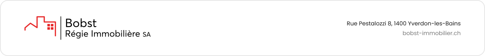

 

## À propos

**Bobst Régie Immobilière SA** est une régie immobilière indépendante établie à Yverdon-les-Bains. Active dans le Nord vaudois et la Broye depuis plus de trente ans, elle accompagne propriétaires, locataires, copropriétaires et investisseurs dans la gestion et la valorisation de leur patrimoine immobilier.

Notre connaissance approfondie du marché local et une équipe pluridisciplinaire nous permettent d'apporter à chaque mandant un conseil précis et des solutions adaptées.

 

## Nos activités

<table>
  <tr>
    <td width="50%" valign="top">
      <b>Gérance d'immeubles</b> 
      Gestion administrative, technique et financière d'immeubles résidentiels et commerciaux.
    </td>
    <td width="50%" valign="top">
      <b>Courtage</b> 
      Estimation, mise en valeur et vente de biens immobiliers, de la première rencontre à la signature.
    </td>
  </tr>
  <tr>
    <td width="50%" valign="top">
      <b>Administration de PPE</b> 
      Administration des propriétés par étages, organisation des assemblées et suivi des copropriétés.
    </td>
    <td width="50%" valign="top">
      <b>Expertises immobilières</b> 
      Évaluations et conseil pour propriétaires, investisseurs et institutions.
    </td>
  </tr>
  <tr>
    <td colspan="2" valign="top">
      <b>BIIP, Bobst Investissement Immobilier Participatif</b> 
      Un service permettant d'investir dans l'immobilier régional aux côtés de la régie.
    </td>
  </tr>
</table>

 

## Nos engagements

| | |
|---|---|
| **Proximité** | Un interlocuteur impliqué et une équipe disponible à chaque étape. |
| **Transparence** | Des informations claires et un suivi rigoureux de chaque mandat. |
| **Expertise locale** | Une connaissance fine du marché du Nord vaudois et de la Broye. |
| **Confiance** | Des relations durables, construites dans l'intérêt de nos mandants. |

 

## Cette organisation

Cet espace regroupe les développements numériques de Bobst Régie Immobilière SA. Les dépôts sont privés et réservés aux collaborateurs de la régie.

 

## Contact

| | |
|---|---|
| **Daniel Vale** | [dpv@bobst-immobilier.ch](mailto:dpv@bobst-immobilier.ch) |
| **Géraldine Candido** | [gca@bobst-immobilier.ch](mailto:gca@bobst-immobilier.ch) |
| **Adresse** | Rue Pestalozzi 8, 1400 Yverdon-les-Bains |
| **Site web** | [bobst-immobilier.ch](https://www.bobst-immobilier.ch) |

 

© Bobst Régie Immobilière SA

